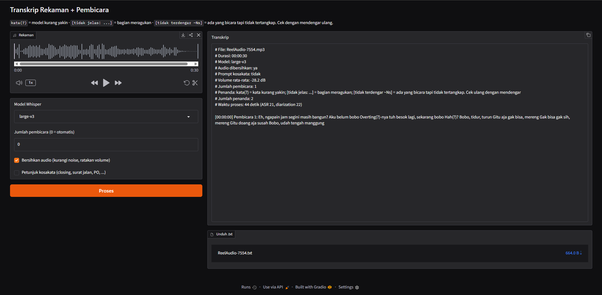
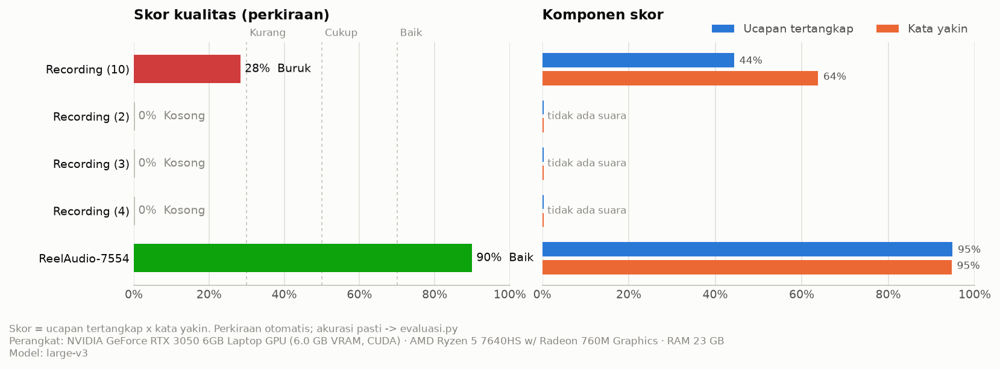
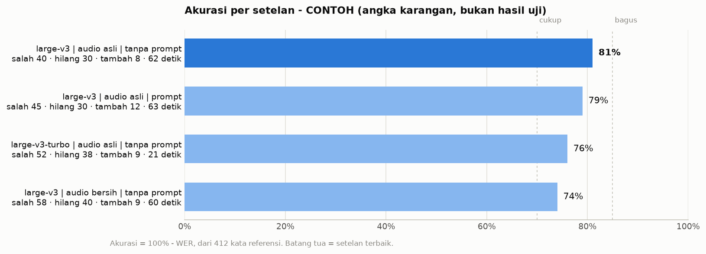

# Transkrip Rekaman + Identifikasi Pembicara



*Tampilan web (`.venv\Scripts\python app.py` → http://127.0.0.1:7860). Cara pakainya ada di bagian [Cara pakai](#cara-pakai).*

Rekaman (m4a/mp3/wav/...) → teks percakapan berlabel pembicara:

```
[00:00:12] Pembicara 1: Jadi untuk proses penanaman biasanya kami mulai dari ...
[00:00:31] Pembicara 2: Itu dicatat(?) di mana, Pak?
[00:00:35] Pembicara 1: [tidak jelas: di buku eh] nanti direkap admin.
```

- `kata(?)`: model kurang yakin dengan kata ini.
- `[tidak jelas: ...]`: seluruh bagian ini meragukan (suara pelan/bising/bertumpuk). **Dengarkan ulang** di menit tersebut.
- `[tidak terdengar ~Ns]`: pyannote mendengar orang ini bicara selama N detik, tapi Whisper tidak menangkap kata apa pun.

## Hasil

- `output/<nama rekaman>.txt`: transkrip. Namanya sama dengan file di `assets/`. Ganti nama rekaman **sebelum** diproses; kalau diganti sesudahnya, ganti juga nama `.txt`-nya, karena kalau tidak rekaman itu akan diproses ulang.
- `output/_laporan_kualitas.txt` + `output/_grafik_kualitas.png`: nilai semua rekaman (Baik/Cukup/Kurang/Buruk/Kosong), dalam bentuk tabel dan grafik. Dibuat otomatis setelah `proses_semua.py`, atau jalankan `python laporan_kualitas.py`.
- `output/data/<nama>.json`: data teknis (waktu per kata, skor keyakinan).

### Grafik kualitas



- **Kiri, Skor kualitas**: satu batang per rekaman. Warna dan tulisan di ujung batang menunjukkan nilainya. Garis putus-putus adalah batas Kurang (30%), Cukup (50%), dan Baik (70%).
- **Kanan, Komponen skor**:
  - *Ucapan tertangkap* (biru): dari seluruh waktu orang bicara, berapa persen yang berhasil jadi teks. Kalau rendah, banyak bagian yang `[tidak terdengar]`.
  - *Kata yakin* (oranye): dari kata yang tertangkap, berapa persen yang tidak ditandai `(?)`/`[tidak jelas]`. Kalau rendah, teksnya ada tapi banyak yang meragukan.
- Skor = tertangkap × yakin. Ini **perkiraan** tanpa kunci jawaban, cocok untuk membandingkan antar rekaman. Untuk angka pasti, lihat bagian berikut.

## Mengukur akurasi

Nilai di laporan kualitas hanya **perkiraan**. Untuk akurasi sebenarnya:
1. Potong 2–3 menit rekaman: `python latihan/01_siapkan_audio.py "assets/Recording (9).m4a" --mulai 300 --durasi 180 --keluar work/eval_rec9.wav`
2. Dengarkan, lalu ketik apa adanya ke `referensi/eval_rec9.txt`.
3. `python evaluasi.py work/eval_rec9.wav referensi/eval_rec9.txt --model large-v3 large-v3-turbo --bersihkan --prompt`

Hasilnya berupa tabel akurasi (100% − WER) untuk setiap kombinasi setelan, diurutkan dari yang terbaik, plus grafik `output/_grafik_evaluasi_<nama potongan>.png`:



*Angka di gambar ini hanya contoh tampilan, bukan hasil uji sungguhan.*

- Batang **biru tua** adalah setelan dengan akurasi tertinggi; pakai setelan ini untuk `proses_semua.py`.
- Di bawah nama setelan tertulis rincian kesalahannya: *salah* (kata tertukar), *hilang* (kata tidak tertangkap), *tambah* (kata yang dikarang model), dan waktu proses.
- Patokan: akurasi ≥ 85% bagus, 70–85% cukup, < 70% berat (sebaiknya perbaiki cara merekam).

Tiap rekaman diproses **terpisah** (beda divisi). Label "Pembicara 1" hanya berlaku di dalam satu file. Ganti nama file di `assets/` sesuai divisi supaya output mudah dikenali.

## Cara pakai

Semua perintah dijalankan dari folder ini.

```bash
.venv\Scripts\python proses_semua.py
```
Memproses semua file di `assets/` → `output/<nama>.txt` (transkrip) + `output/data/<nama>.json` (data lengkap). File yang sudah punya output akan dilewati.

Opsi:
- `--model large-v3-turbo`: lebih cepat; default `large-v3` (paling tepat)
- `--jumlah 2`: isi jumlah pembicara kalau sudah tahu (hasil biasanya lebih rapi)
- `--bersihkan`: kurangi noise + ratakan volume sebelum diproses
- `--prompt`: beri petunjuk kosakata (closing, surat jalan, PO, ...). Istilah jadi lebih tepat, tapi pada audio sangat buruk model bisa "mengarang", jadi bandingkan dulu
- `--ulang`: proses ulang walaupun output sudah ada

Tampilan web:
```bash
.venv\Scripts\python app.py
```
lalu buka http://127.0.0.1:7860 (tampilannya seperti gambar di paling atas).

1. **Rekaman**: upload file audio (m4a/mp3/wav/...).
2. **Model Whisper**: biarkan `large-v3` (paling tepat).
3. **Jumlah pembicara**: isi kalau tahu berapa orang; `0` = otomatis.
4. **Bersihkan audio**: kurangi noise dan ratakan volume. Coba kalau rekamannya bising.
5. **Petunjuk kosakata**: bantu istilah kerja (closing, surat jalan, PO). Matikan kalau hasilnya jadi aneh.
6. Klik **Proses**. Transkrip muncul di kanan, dan file `.txt`-nya bisa diunduh di bawahnya (juga tersimpan di `output/`).

## Spesifikasi & kecepatan

Semua hasil di proyek ini dibuat dengan perangkat berikut. Setiap transkrip juga mencatat perangkatnya sendiri: baris `# Perangkat` di `.txt`, dan blok `sistem` di `.json`. Bagian `SPESIFIKASI` di laporan kualitas dan keterangan di bawah setiap grafik ikut mencantumkannya.

| Komponen | Yang dipakai |
|---|---|
| GPU | NVIDIA GeForce RTX 3050 6GB Laptop GPU (driver 617.42) |
| CPU | AMD Ryzen 5 7640HS |
| RAM | 24 GB |
| Sistem operasi | Windows 11 (build 26200) |
| Python | 3.12 (venv `.venv`) |
| PyTorch | 2.11.0 + CUDA 12.8 |
| Speech-to-text | faster-whisper 1.2.1 (ctranslate2 4.8.2), model **large-v3**, mode `int8_float16` |
| Pengenal pembicara | pyannote.audio 4.0.7, model **speaker-diarization-community-1**, TF32 aktif |

Kecepatan terukur di perangkat ini:

| Tahap | Hasil uji | Catatan |
|---|---|---|
| Speech-to-text (Whisper large-v3) | 28 mnt → 55 detik (`Recording (10)`, banyak hening)<br>103 mnt → 9,9 menit (`Recording (5)`, padat bicara) | **±10–30x** lebih cepat dari durasi. Makin padat percakapan, makin lama. |
| Pengenal pembicara (pyannote) | 28 mnt → 100 detik | ±17x. Sebelum TF32 dinyalakan, ±6x lebih lambat. |
| **Perkiraan total** | 1 jam rekaman ≈ **5–10 menit** | Angka nyata per rekaman ada di kolom *Proses* & *Kecepatan* di laporan |
| Pemakaian VRAM | ±4 GB dari 6 GB | Whisper & pyannote dijalankan bergantian |

Di GPU lain kecepatannya berbeda. Tanpa GPU NVIDIA (CPU saja) program tetap jalan, tapi bisa 10–30x lebih lambat. Kolom **Proses** dan **Kecepatan** di `_laporan_kualitas.txt` menunjukkan angka nyata tiap rekaman.

## Git: apa yang di-push dan tidak

Diatur di `.gitignore`:

| Tidak di-push | Alasan |
|---|---|
| `.env` | Berisi token Hugging Face. Yang di-push hanya `.env.example`. |
| `assets/*` | Rekaman wawancara (data perusahaan, ukurannya besar). **Kecuali `assets/test/`**: taruh rekaman uji pendek yang boleh dibagikan di sini. |
| `output/` | Transkrip dan laporan berisi isi wawancara. |
| `referensi/*` | Transkrip manual untuk evaluasi, juga berisi isi wawancara. |
| `work/`, `.venv/`, `__pycache__/` | File sementara dan lingkungan Python; bisa dibuat ulang. |

Setelah clone di komputer lain: buat venv dan pasang paket (lihat di bawah), salin `.env.example` jadi `.env`, lalu taruh rekaman di `assets/`.

## Persiapan sekali saja (sudah dilakukan)

1. ffmpeg: `winget install Gyan.FFmpeg`
2. venv Python 3.12: `python -m uv venv -p 3.12 .venv`
3. Paket: `python -m uv pip install -p .venv -r requirements.txt --index-strategy unsafe-best-match`
4. **Token Hugging Face** (untuk pyannote):
   - Buat akun di huggingface.co → Settings → Access Tokens → buat token jenis *Read*.
   - Buka https://huggingface.co/pyannote/speaker-diarization-community-1 dan setujui syaratnya.
   - Salin `.env.example` jadi `.env`, isi `HF_TOKEN=hf_...`
5. Cek: `.venv\Scripts\python latihan\00_cek_lingkungan.py`

## Struktur & alur (tahap belajar)

| Tahap | File | Isi |
|---|---|---|
| 0 | `latihan/00_cek_lingkungan.py` | Cek Python, ffmpeg, GPU, token |
| 1 | `src/transkrip/audio.py`, `latihan/01_siapkan_audio.py` | ffmpeg: ke WAV 16 kHz mono, potong, bersihkan |
| 2 | `src/transkrip/asr.py`, `latihan/02_asr.py` | faster-whisper: segmen + waktu + skor keyakinan per kata |
| 3 | `src/transkrip/diarize.py`, `latihan/03_diarize.py` | pyannote: interval "SPEAKER_00 bicara detik 3–9" |
| 4 | `src/transkrip/gabung.py`, `latihan/04_gabung.py` | Cocokkan kata ↔ pembicara (overlap terbesar), gabung, relabel, tandai bagian ragu |
| 6 | `app.py` | Gradio |
| 7 | `proses_semua.py` | Batch semua rekaman |
| 7 | `src/transkrip/kualitas.py`, `laporan_kualitas.py`, `evaluasi.py` | Skor kualitas (perkiraan) dan akurasi WER (dengan kunci jawaban) |
| 7 | `src/transkrip/grafik.py` | Grafik kualitas & akurasi (matplotlib) |

Latihan dijalankan berurutan pada potongan pendek supaya cepat:
```bash
.venv\Scripts\python latihan\01_siapkan_audio.py "assets\Recording (10).m4a" --mulai 60 --durasi 120
.venv\Scripts\python latihan\02_asr.py --model small large-v3
.venv\Scripts\python latihan\03_diarize.py
.venv\Scripts\python latihan\04_gabung.py
```

## Menyetel hasil (Tahap 7)

- Ambang penandaan ada di atas `src/transkrip/gabung.py` (`AMBANG_KATA`, `AMBANG_LOGPROB`, ...). Terlalu banyak `(?)` → turunkan `AMBANG_KATA`. Bagian jelek lolos tanpa tanda → naikkan.
- Pembicara tertukar/terpecah jadi terlalu banyak → pakai `--jumlah N`.
- Rekaman bising → coba `--bersihkan`, lalu bandingkan dengan tanpa (kadang filter malah menurunkan akurasi).
- Hasil uji awal (Okt 2026): VAD dengan ambang 0.3 (bukan default 0.5) menangkap jauh lebih banyak ucapan pelan. Filter `--bersihkan` dan `dynaudnorm` **tidak** membantu `Recording (10)` (volume −39 dB, pembicara jauh dari mikrofon), dan Whisper malah mengarang kalimat "Terima kasih telah menonton". Kalimat seperti itu sekarang otomatis dibuang (`KALIMAT_HALUSINASI` di `gabung.py`).
- Untuk rapat berikutnya: letakkan HP/perekam di tengah meja, dekat orang yang paling banyak bicara. Itu jauh lebih berpengaruh daripada setelan model apa pun.
- GPU 6 GB: Whisper dan pyannote dijalankan bergantian, VRAM dikosongkan di antaranya.

## Tahap 5: WhisperX (opsional)

WhisperX membungkus tahap 2–4 dalam satu paket. Pemetaannya ke kode ini:
- `whisperx.load_model().transcribe()` = `asr.py`
- `whisperx.align()` = timestamp per kata (di sini dari `word_timestamps=True` faster-whisper)
- `DiarizationPipeline` = `diarize.py`
- `whisperx.assign_word_speakers()` = `gabung.py`

Pin versi dependensinya sering bentrok dengan paket di sini, jadi kalau mau mencoba pasanglah di venv terpisah.
